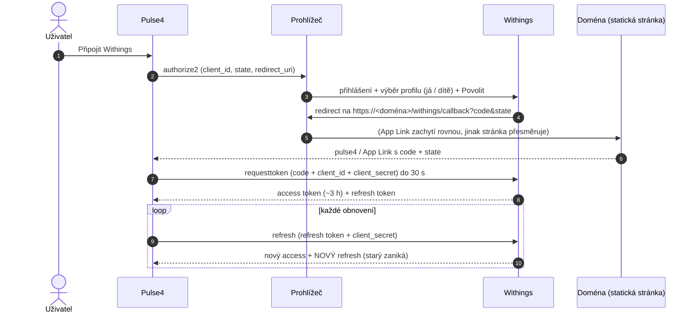

# Withings

Stav k 7. 11. 2026. Plný konektor Withings (`WithingsWebClient`, `WithingsWebMapper`, `WithingsWebFetcher`, `WithingsDirectAuth`, `WithingsNativeLoginForm`) je implementován a integrován napříč aplikací. Veškeré přihlašování (včetně účtů vedených přes **Google**, **Apple**, účtů bez hesla přes 8místný e-mailový kód i účtů s heslem) a výběr hlavního i dětského profilu probíhá **100% na pozadí v nativním formuláři bez WebView**.

## Mapování metrik Withings Body Scan / Body Comp (ověřeno na reálném HAR i zařízení)

- **Celotělové vs. segmentální pozice (`position = 7` vs `position = null`)**:
  - Váhy Withings Body Scan / Body Comp vracejí v jedné skupině (`measuregrp`) jak klasické celotělové metriky s `position = null` (`type 1` váha, `type 6` % tuku, `type 11` tep, `type 91` PWV, `type 155` cévní věk), tak celotělové metriky uložené pod **`position = 7` (Whole Body)**:
    - `type 5`: Beztuková hmota (`FAT_FREE_MASS`, kg)
    - `type 76`: Svalová hmota (`MUSCLE_MASS`, kg)
    - `type 77`: Tělesná voda (`BODY_WATER`, v API v kg → přepočteno na `%` z váhy ve stejné skupině nebo nejbližšího vážení ±300 s)
    - `type 88`: Kostní hmota (`BONE_MASS`, kg)
    - `type 170`: Viscerální tuk (`VISCERAL_FAT`, index)
    - `type 226`: Bazální metabolismus (`BMR`, kcal)
    - `type 227`: Metabolický věk (`METABOLIC_AGE`, roky)
  - Segmentální hodnoty končetin a trupu (`position` 2 = Pravá ruka, 3 = Levá ruka, 12 = Trup, 10 = Pravá noha, 11 = Levá noha) se uchovávají v `segmentalItems` a nikdy nepřepisují celotělové skalární metriky (priorita výběru v `WithingsWebMapper` i `WithingsMapper`: `position == null` → `position == 7` → `position == 0`).
  - **Segmentální rozložení svalů a tuku (`type 173`, `type 174`, `type 175`)**:
    - `WithingsWebMapper.buildSegmentalOriginSuffix` extrahuje ze skupin `measuregrp` segmentální měření z Withings Body Scan:
      - `type 175` (`SEGMENT_MUSCLE`, kg): svalová hmota pro pozice `2` (Pravá ruka, např. `4.56 kg`), `3` (Levá ruka, `4.60 kg`), `12` (Trup, `35.66 kg`), `10` (Pravá noha, `12.73 kg`), `11` (Levá noha, `12.54 kg`) – součet `70.09 kg`.
      - `type 174` (`SEGMENT_FAT`, kg): tuková hmota pro pozice `2` (`0.81 kg`), `3` (`0.81 kg`), `12` (`12.58 kg`), `10` (`2.55 kg`), `11` (`2.69 kg`) – součet `19.44 kg`.
      - `type 173` (`SEGMENT_FAT_FREE`, kg): beztuková hmota pro pozice `2, 3, 12, 10, 11`.
    - Hodnoty se kódují do `origin` pozorování (`|segm:2=...,3=...,12=...,10=...,11=...|segf:...|segffm:...`) a v UI (`SegmentalBodyCompositionSection` v `PersonalScreens.kt`) se zobrazují jako interaktivní tabulka s přepínačem **Svaly / Tuk**, vyhodnocením pravo-levé symetrie končetin a **rozklikávacím historickým grafem** pro každou část těla i společné porovnání všech 5 segmentů.
- **Sdružené metriky, zobrazení posledních známých hodnot po půlnoci a sémantické barvy (`PersonalScreens.kt`)**:
  - **Poslední známé hodnoty (`Dnes`)**: Pokud po půlnoci (`00:00`) ještě neproběhlo měření pro aktuální den, obrazovka `Dnes` automaticky zobrazí poslední známou hodnotu z databáze s jasným označením stáří (`Dnes`, `Včera`, `Poslední (MM-DD)`).
  - **Sémantické barvy a vysvětlení (`evaluateMetricHealth`, `MetricMeaningAndRangesCard`)**: Každá metrika má fyziologické vysvětlení a referenční pásma barevně odlišená: **Pozitivní / Optimální = zelená (`#10B981`)**, **Hraniční = jantarová (`#F59E0B`)**, **Negativní / Rizikové = červená (`#EF4444`)**. Stejně se barví i samotná hodnota a odchylka `Δ vs medián`.
  - **Sdružené metriky**:
    - **Váha & Složení těla (Withings + Garmin)**: spojuje hmotnost, % tuku, svalovou hmotu, viscerální tuk, % vody, beztukovou hmotu, kosti, BMR, metabolický věk a segmentální rozložení Ruce/Trup/Nohy.
    - **Srdce & Cévy (Garmin + Withings)**: spojuje klidový tep a noční HRV z Garminu s EKG, rychlostí pulzové vlny (PWV) a cévním věkem z Withings.
    - **Regenerace & Energie (Garmin)**: spojuje spánek, skóre spánku, Body Battery, HRV a stres.
  - **Skládaný plošný graf (Stacked Area Chart) pro Váhu, Svaly a Tuk (`WeightCompositionStackedAreaChart` v `Common.kt`)**:
    - Vykresluje vrstvy aktivních svalů (zelená `#10B981`) a tuku (oranžová `#F59E0B`) přímo pod křivkou celkové hmotnosti.
    - Přepínač mezi detailním pohybem váhy a absolutní škálou od 0 kg.
    - Sjednocené přepínání jednotek celého kokpitu do kilogramů (`kg`) nebo procent (`%`) bez míchání jednotek.
  - **Zdrojově specifický Viscerální tuk**:
    - Pro Withings Body Scan (`WITHINGS_API`) se používá desetinná stupnice `0,0–20,0 idx` s referencí `0,0–2,9 idx` (optimální), `3,0–4,4 idx` (střední), `≥ 4,5 idx` (vysoký).
    - Pro Garmin a běžné váhy bez madla se používá celočíselná škála `1–59`.
  - **Matematika BMR a Metabolického věku**:
    - Withings Body Scan počítá BMR (`type 226`) absolutně v kcal/den, ale metabolický věk (`type 227`) stanovuje z relativního poměru BMR k 1 kg celkové váhy a % tělesného tuku ve srovnání s věkovými průměry. Proto hodnota 41 let při 93 kg váhy a 23,2 % tuku odpovídá normálnímu stavu.
  - **Ochrana profilů (`primaryUserId`)**:
    - `WithingsService.trend()` i `latestBodyComposition()` striktně filtrují pozorování podle `primaryUserId` aktivního profilu, aby se nemíchaly váhy různých rodinných příslušníků.
- **Kvalita skupin (`attrib = 8` a `attrib = 5`)**:
  - Váha Withings Body Scan ukládá cévní metriky (`PWV` typ 91 a `VASCULAR_AGE` typ 155) do samostatné skupiny se stejným časovým razítkem a `attrib = 8`. V `WithingsWebConfig.attribQuality` jsou proto `0`, `2`, `5`, `7` a `8` mapovány na `Quality.OK`.
- **EKG (`v2/heart?action=list` a `v2/signal?action=get`)**:
  - Seznam záznamů EKG se stahuje přes `v2/heart?action=list` (bez omezujícího `startdate`, protože endpoint vrací stránkovanou historii záznamů `series` s `ecg.signalid`, `afib` a případně `heart_rate` / `qtc`).
  - Pokud v `v2/heart?action=list` není přímo vyplněn `heart_rate`, spáruje `WithingsWebMapper.mapEcgSummaries` záznam EKG se souběžným měřením tepu z váhy (`type 11` v okně ±300 s).
  - Při rekonciliaci tombstonů (`Reconcile.tombstones`) jsou ID záznamů EKG (`withings:<userId>:ecg:<signalid>:ECG`) i modifikovaných záznamů zahrnuta do `fetchedIdsInWindow`, takže se při synchronizaci nikdy nesmažou.
  - Plná křivka EKG (15 000 vzorků, `with_filtered=true`, 500 Hz) se stahuje přes `WithingsWebClient.getSignal` a ukládá do `withings_ecg_signal`.

## Aktuální směr: přihlášení na pozadí bez developer účtu a bez WebView (Implementováno)

Požadavek uživatele: žádný developer účet ani pro autora, žádný vlastní server, žádný ruční export při každé
synchronizaci a žádné matoucí bílé okno WebView. K tomu slouží **přímý konektor Withings** v modulu `connector-withings` a přihlašovací služby v `app` (`WithingsDirectAuth`, `WithingsNativeLoginForm`, `WithingsWebLoginDialog`, `WithingsService`):
- **Google / Apple / Kód z e-mailu (výchozí režim)**: Účty založené přes *Continue with Google* nebo *Continue with Apple* nemají vlastní heslo Withings. Po zadání e-mailu (nebo 1klik выбора Google účtu z telefonu) zavolá `WithingsDirectAuth.requestEmailCode` na pozadí `account.withings.com/new_workflow/login`, čímž Withings odešle 8místný ověřovací kód na e-mail (s možností opakovaného zaslání přes `scalews.withings.com/cgi-bin/v2/account?action=createshortcode`). Po zadání kódu v nativním poli získá aplikace `session_token` / `session_key` / `sessionid` cookies a načte profily.
- **E-mail + Heslo Withings**: Klasické přihlášení na pozadí přes `new_workflow/password_check` s automatickým přechodem na 8místný kód při zapnutém 2FA nebo u účtů bez hesla.
- Původní OAuth 2.0 konektor a CSV import zůstávají k dispozici jako záložní cesty.

### Co doložil HAR

Analyzován uživatelem dodaný `app.withings.com.har`: 35 požadavků, z toho 34 na
`https://scalews.withings.com/cgi-bin/` a jeden na překlady webu. Všech 34 odpovědí webového API má HTTP 200
a aplikační `status: 0`. Jde o zaznamenané odpovědi, nikoli nové živé volání API. Analýza neodesílala žádné
požadavky s přihlašovacími údaji z HAR. Osobní údaje, ID, hodnoty měření a původní HAR se do repozitáře nekopírují.

Záznamy jsou níže číslovány od nuly podle `log.entries`.

| Endpoint za `/cgi-bin/` | `action` | Doloženo v HAR |
|---|---|---|
| `v2/account` | `get` | Účet a seznam dvou profilů; záznam 0. |
| `account` | `getuserslist` | Dva profily se samostatným ID; záznam 1. |
| `measure` | `getmeas` | Detailní měření; rozsah `startdate`/`enddate`, volitelný `meastype`; záznamy 20 a 24 obsahují plné složení těla. |
| `measure` | `getmeas` | `meastype=4`, `lastupdate=0`: historie výšky včetně sedmi smazaných skupin; záznam 8. |
| `measure` | `getmeas` | Čtení váhy druhého profilu, 12 záznamů v rozpětí přibližně 419 dní; záznam 28. |
| `v2/summary` | `getbyuserid` | Souhrny; záznam 6. |
| `v2/aggregate` | `getbyuserid` | Agregace podle typu a období; záznamy 9, 17, 21, 25, 29, 32. |
| `v2/heart` | `list` | 45 položek se strukturou `ecg.signalid` a dalšími metadaty; záznam 14. |
| `v2/signal` | `get` | Konkrétní signál, jeho metadata a `filtered_data` s 15 000 položkami; záznam 31. |
| `v2/activity` | `getbyuserid` | Úspěšné, ale prázdné odpovědi: skutečné mapování aktivit tím není ověřeno. |
| `v2/measure` | `getmeas` / `getagregatewam` | Úspěšné, ale prázdné odpovědi. Nezaměňovat s neprázdným `/measure`. |

Požadavky používají POST s formulářovými parametry a identifikací webového klienta `appname`, `apppfm`,
`appliver`. Konektor musí hodnotit i JSON `status`, nikoli pouze HTTP status.

Ve všech odpovědích `/measure` je celkem 35 různých skupin, z toho sedm smazaných, a 304 položek měření
37 různých typů. Přítomné jsou mimo jiné váha (1), výška (4), beztuková hmota (5), tuk v procentech (6)
a kg (8), tep (11), svaly (76), voda (77), kosti (88), PWV (91), cévní věk (155), vnější/vnitřní buněčná
voda (168/169), viscerální tuk (170), segmentální složení těla (173–175), bazální metabolismus (226)
a metabolický věk (227). Význam pokročilých typů vychází z konstant veřejného JavaScriptu Withings;
nepovažovat názvy za klinickou interpretaci ani všechny jednotky za ověřené.

### Co HAR neobsahuje

- Žádné požadavky přihlášení, MFA, obnovení nebo prodloužení relace.
- Žádné hlavičky `Cookie`, `Authorization`, `Set-Cookie` ani položky v polích cookies. Export tedy
  neposkytuje přihlašovací relaci k přehrání. **Absence cookies v exportu neznamená veřejné API bez autentizace.**
- Žádnou skutečnou další stránku výsledků ani nenulový inkrementální `lastupdate`.
- Žádná neprázdná data spánku či aktivit. Nelze z něj slíbit úplný obsah všech zařízení nebo všech účtů.

Veřejný webový JavaScript samostatně dokládá použití cookies (`withCredentials`) / `sessionid`, volitelného
`session_token`, čtení měření a operace `session?action=extend`. Životnost a možnost obnovy běžné relace
bez interakce uživatele zůstávají neověřené. Zdrojem byly balíky `main.87d703d8.js` a `vendors.6a1aa918.js`
odkazované webem Withings. Statický kód neprokazuje úspěšné přihlášení z Android WebView.

### Návrh uživatelského průchodu

1. „Připojit Withings“ otevře nativní přihlašovací dialog P4 (bez WebView; OkHttp HTML/form tok proti `account.withings.com`), včetně podpory 2FA kódu. Heslo se ukládá šifrovaně v Android Keystore jen v telefonu a slouží k automatickému obnovení spojení, když vyprší relace; lze vypnout. (zaškrtávátko „Pamatovat heslo pro automatické obnovení“, výchozí zapnuto). E-mail účtu se pamatuje vždy.
2. Po dokončení přihlášení konektor ověří relaci čtením účtu a nabídne seznam profilů. Uživatel vybere svůj
   profil a případně profil dítěte. Data se přiřazují podle `userid`, nikoli odhadem podle váhy.
3. Relace (šifrované cookies důvěryhodného zařízení a `session_token`) zůstane pouze na daném telefonu v úložišti šifrovaném pomocí Android Keystore a nevstupuje do záloh ani logů.
4. První import načte dostupnou historii po ověřených časových oknech. Další importy čtou změny a kontrolní
   překryv při otevření aplikace a přes WorkManager. Interval není zárukou přesného času provedení na Androidu.
5. Při neplatné relaci zobrazit „Obnovit přihlášení“, zachovat historii a kurzor. Nepředpokládat trvalou platnost
   relace ani použitelnost OAuth refresh tokenů pro tento konektor.
6. Rodičovský telefon může číst vybraný profil dítěte a poslat jeho data stávající P2P cestou. Přihlašovací
   relace rodiče se dítěti neposílá. Současná zpráva `family.weight.push` nepřenáší celé složení těla.

### Nutné změny proti současnému konektoru

- Samostatná webová relace a provider; pouhá výměna URL v OAuth konektoru nestačí.
- Zachovat celou zdravotní skupinu včetně `modified`, `deleted`, `attrib`, `timezone`, `position`,
  `algo` a neznámých typů. Neuchovávat kompletní odpověď účtu, která obsahuje také nepotřebné citlivé údaje.
- Skalární hodnota používá `value * 10^unit`; jednotka a význam metriky se mapují zvlášť.
- Současný `Measure(type, value)` ztrácí `position`. Klíč pouze `grpid + type` by v tomto HAR vytvořil
  **180 kolizí**. Klíč rozšířit alespoň na provider + profil + grpid + typ + pozici; další případné kolize
  nesmí nic přepsat. V tomto vzorku rozlišení pozice všechny kolize odstraní. Původní skupinu zachovat
  i pro budoucí dosud neznámé rozměry. Chybějící pozice není totéž co pozice nula.
- Zpracovat explicitní `deleted` i bez položek `measures`; sedm takových záznamů je přímo ve vzorku.
  Nepřítomnost záznamu v neúplné, filtrované nebo prázdné odpovědi není sama důkaz smazání.
- Časové pásmo není ve všech skupinách; použít ověřené pásmo profilu s evidencí původu.
- Nové hodnoty `attrib` uchovat a jejich význam ověřit. Neodvozovat osobu ani kvalitu segmentálních
  měření pouze z číselného kódu bez doloženého mapování.
- Kurzory ukládat až s úspěšným commitem dat; pro `lastupdate` ověřit význam serverového `updatetime`,
  hranice a stránkování. Podpora `lastupdate=0` zatím nedokazuje úplnou inkrementální synchronizaci.
- Rozšířit doménový model a UI o celé složení těla; segmenty a EKG mají vlastní rozměry/formát.
  EKG signál ukládat odděleně, nikoli jako skalární `MetricObservation`.

### Nejbližší ověření

Datový formát a čtení obou profilů jsou doložené. Další krok je malý Android prototyp přihlášení a čtení
jednoho vážení. Ověřit relaci po restartu aplikace/telefonu, na pozadí a po několikadenní neaktivitě,
nové i opravené/smazané měření, úplnost historie a oddělení profilů. Teprve potom označit automatickou
synchronizaci za funkční. HAR slouží pouze jako podklad pro vývoj; budoucí běžná synchronizace jej nepotřebuje.

Health Connect zůstává volitelnou cestou s omezeným doloženým rozsahem. Android podporuje vodu, kosti
a beztukovou hmotu, ale nemá samostatný standardní typ svalové hmoty; není doloženo, že Withings zapisuje
všechny podporované typy. Beztuková hmota není svalová hmota. Viz
[datové typy Androidu](https://developer.android.com/health-and-fitness/health-connect/data-types) a
[export Withings do Health Connect](https://support.withings.com/hc/en-us/articles/27322856325905-Partner-Apps-Health-Connect-Exporting-Withings-data-into-Health-Connect).

## Historický návrh: OAuth (nahrazen výše uvedeným směrem)

Následující části popisují dosavadní implementaci a původní plán. Registrace developer aplikace,
zabudování společného secretu a callback doména nejsou úkoly pro novou webovou cestu.

| Otázka | Rozhodnutí |
|---|---|
| Hlavní cesta k datům | **Přímé Withings API (OAuth)**, protože uživatelé chtějí plná data (tuk, svaly, voda, kosti…). |
| Kdo registruje aplikaci u Withings | **Jednou autor Pulse4** (jedna organizace a jedna aplikace na developer.withings.com). Uživatelé nic neregistrují. |
| Kde je `client_secret` | **V aplikaci** (vloží se při buildu z `local.properties`, mimo git). Pro rodinu a známé je to přijatelné riziko, viz níže. |
| Obnova (rotace) tokenů | **V aplikaci**, žádný server. |
| Návrat z přihlášení | Statická stránka na vlastní doméně (`https://<doména>/withings/callback`). |
| Health Connect | **Nepoužíváme**: uživatelé data do Health Connect neposílají. Kód zůstává, v UI není. |
| CSV a ruční zápis | Zůstávají jako záložní cesty bez připojení. |

> **Stav implementace:** UI pro OAuth, výměna kódu, rotace tokenů, dětský profil a P2P přeposílání jsou hotové.
> **Původně zbývalo:** registrace aplikace u Withings, nasazení callback stránky na doménu, přesunutí `client_id`/`client_secret` z UI
> do buildu a zjednodušení UI na jediné tlačítko „Připojit Withings“. Tyto úkoly nahrazuje webový prototyp popsaný výše.

---

## Jak přihlášení funguje (lidsky)

Přirovnání k hotelu: **Withings** je hotel s daty, **uživatel** je host, **Pulse4** je poslíček.

1. **Poslíček se jednou zaregistruje v hotelu.** Autor Pulse4 založí na developer.withings.com organizaci a aplikaci
   a dostane **Client ID** (číslo průkazu) a **Client Secret** (heslo poslíčka). Dělá se to jednou za celou aplikaci.
2. **Host dá souhlas.** Uživatel v Pulse4 klikne „Připojit Withings“, otevře se stránka Withings, přihlásí se svým
   běžným účtem (heslo může vyplnit Bitwarden) a klikne „Povolit“. Pulse4 heslo uživatele nikdy nevidí.
3. **Poslíček dostane klíč od pokoje (access token).** S ním Pulse4 stahuje data.
4. **Klíč platí asi 3 hodiny.** Pulse4 ho na pozadí vymění za nový (refresh token). **Při každé výměně chce Withings
   vidět Client Secret**, proto ho musí mít ten, kdo obnovu dělá, v našem případě aplikace.

### Proč je Secret v aplikaci a co to znamená

- Withings v dokumentaci **nenabízí PKCE**, takže mobilní aplikace se bez Secretu neobejde (ani při obnově tokenu).
- Alternativa je malá výměnná služba (např. Cloudflare Worker), která by Secret držela na serveru. Pro okruh rodiny a
  známých jsme ji **zamítli jako zbytečnou** a necháváme ji jako možnost před veřejným vydáním na Google Play.
- **Kdyby někdo Secret z APK vytáhl:** k datům uživatelů se nedostane (potřeboval by souhlas a tokeny konkrétního
  uživatele, ty jsou jen v jeho telefonu v Android Keystore). Mohl by se jen vydávat za Pulse4 a ujídat limit uživatelů.
  Náprava: ve Withings dashboardu přegenerovat Secret a vydat novou verzi.

### Proč je potřeba doména

Po kliknutí „Povolit“ Withings přesměruje jen na `https://` adresu, ne přímo do aplikace (vlastní schéma `pulse4://`
ani `localhost` portál podle dostupných zdrojů nepřijímá, neověřeno). Na doméně proto bude jedna statická stránka:

| Varianta návratu | Popis | Stav |
|---|---|---|
| **App Link** | `/.well-known/assetlinks.json` s SHA-256 otiskem podpisového klíče; Android otevře rovnou Pulse4. | Hotovo v kódu (`docs/withings-applink/`). Otisk se liší pro debug / release / Google Play. |
| **Přesměrovací stránka** | `/withings/callback` přesměruje na `pulse4://withings/callback?code=…` + tlačítko „Otevřít Pulse4“. | Navrženo jako záloha, nezávislá na podpisovém klíči. |
| **GitHub Pages** | Stejná stránka na `livinglegendcz.github.io` (bez vlastní domény). | Alternativa, repo `pulse4` je soukromé → potřeba samostatné veřejné repo. |

Stránka nic neukládá a nemá analytiku. Vidí jen jednorázový kód, který bez Secretu a do 30 s nic neznamená.

### Sekvence

---

## Účty, rodina a dítě

- Každý dospělý se připojí **svým** Withings účtem.
- **Dítě nemá vlastní Withings účet**: je to vedlejší profil (*Family member*) pod účtem rodiče, má ale vlastní `userid`.
  Dítě přitom **má vlastní Garmin**, takže váhu potřebuje ve svém Pulse4.
- Řešení: rodič připojí **druhý OAuth token pro dětský profil** (`withings.child.tokens`, při přihlášení vybere dítě)
  a Pulse4 posílá dětská vážení přes šifrované P2P zprávou `family.weight.push` do telefonu dítěte. Tam se uloží do
  jeho vlastní tabulky `observation` (pokud má dítě zapnuto „Přijímat moji váhu od rodiče“).
- Volitelně lze přeposílat i vážení z rodičova profilu v dětském pásmu (`childWeightMinKg..childWeightMaxKg`,
  výchozí 12–45 kg) nebo poslat váhu ručně.
- **Filtr cizích vážení** (`weightFilterMinKg..MaxKg`, výchozí 45–130 kg) vyřadí z trendu rodiče vážení dítěte nebo
  vážení s dítětem v náručí. Nejednoznačná měření (`attrib` 1/5/8) se drží mimo graf, dokud je uživatel nepotvrdí.

---

## Uživatelské rozhraní (Nastavení → 🔗 Garmin & Withings)

Tři dlaždice nahoře, vždy je vidět jen jedna sekce:

| Dlaždice | Obsah |
|---|---|
| ⌚ **Garmin** | Přihlášení (e-mail s tlačítkem „👤 Vyplnit e-mail z účtů v telefonu“ přímo pod polem, heslo s podporou Bitwardenu, MFA), osobní API klíč s „❓ Kde získat?“, Sync, poslední synchronizace oblastí. |
| ⚖️ **Withings** | Stav, „❓ Kde získat?“ (3 kroky + odkaz na portál + kopírování Callback URL), Client ID/Secret, Připojit/Sync/Odpojit, filtr cizích vážení, ruční zápis a import CSV. |
| 🧒 **Dítě** | 1. komu posílat (P2P kontakt), 2. odkud brát váhu (dětský profil / poslat / ručně), přepínač na telefonu dítěte. |

Kód: `SourcesSettingsSection`, `AccountCard`, `HelpBox` v `app/src/main/kotlin/app/pulse4/android/ui/SettingsHubScreen.kt`.
Snímky: `vault/attachments/settings_accounts_*.png`.

> Pole Client ID/Secret a návod „Kde získat?“ v záložce Withings jsou **přechodné**. Po zabudování přístupů do buildu
> z UI zmizí a zůstane jen „Připojit Withings“.

---

## ADR: Web login jako hlavní cesta (2026-11-18)

**Rozhodnutí:** Přihlášení e-mailem a heslem přes nativní formulář napodobující webové rozhraní Withings (`WithingsDirectAuth` + `WithingsWebClient`) je **hlavní a záměrná cesta** integrace Withings.

**Důvody:**
- Oficiální Withings OAuth API vyžaduje, aby si každý uživatel založil vlastní developer organizaci a aplikaci na `developer.withings.com`, což je pro běžného uživatele (BFU) nepoužitelné.
- Sdílený `client_secret` na vlastním token-broker serveru je v přímém rozporu s principem **Zero Cloud** (Pulse4 nemá žádný vlastní server).
- Health Connect poskytuje pouze váhu a tělesný tuk (nikoli svaly, kosti, vodu, viscerální tuk, PWV, EKG), takže slouží jen jako záloha.

**Rizika a mitigace:**
- *Změny HTML / rozhraní Withings a ToS:* třída `WithingsDirectAuth` klasifikuje neznámé stavy odděleně a neopakuje chybné pokusy.
- *Zablokování účtu (lockout / 429):* `WithingsSessionCoordinator` obsahuje perzistovaný circuit-breaker a exponenciální backoff při síťových chybách; při chybě hesla / 429 / 2FA okamžitě zastaví automatické pokusy. Když tiché SSO selže a heslo je zapamatované, zkusí se na pozadí jedno přihlášení heslem nejvýše jednou za 6 h (odmítnuté heslo se smaže; 2FA / 429 pozastaví obnovu do ručního přihlášení).
- *Bezpečnost hesla:* Heslo se ukládá šifrovaně v Android Keystore jen v telefonu a slouží k automatickému obnovení spojení, když vyprší relace; lze vypnout. Ukládá se výhradně v šifrovaném SecretStore (nikdy v Room DB, nastavení, zálohách ani logu) a maže se při odpojení účtu nebo při odmítnutí heslem.
- *Diagnostika:* Nastavení → Withings → „Diagnostika Withings“ ukazuje redigovaný průběh posledních pokusů (cesty URL bez parametrů, HTTP stav, výsledek; max. 30 záznamů) s tlačítkem „Zkopírovat“.
- *OAuth režim:* zůstává pouze jako volitelná záložní cesta pro pokročilé uživatele s vlastním developer účtem.

## Udržování relace a tiché obnovení (2026-11-20)

Cíl: uživatel se nemusí ručně přihlašovat, dokud jsou přihlašovací údaje platné. Skutečná doba života webové relace
Withings na serveru **není z kódu ani z HAR ověřitelná** (dřívější údaj „~48 h“ nemá zdroj), proto se relace udržuje
často a levně a při zániku se obnoví sama.

- **Keepalive** (`session?action=extend`): každých 30 minut (`AutoSyncPlanner.KEEPALIVE_INTERVAL_MS`), nezávisle na intervalu
  importu dat, při startu aplikace (po 45 s) a při návratu aplikace do popředí. Neblokuje ho `AutoImportPolicy`,
  ochranná lhůta po startu ani single-flight guard importu.
- **Žebřík obnovy** (`WithingsSessionCoordinator`): extend → tiché SSO přes dlouhodobé cookies `account.withings.com` →
  jedno přihlášení uloženým e-mailem a heslem.
- **Limity:** selhání sítě = exponenciální backoff 1 → 30 min; neklasifikované selhání obnovy = cooldown 15 min → 1 h → 3 h →
  6 h (počítá se jen skutečný pokus, přeskočená volání ne); HTTP 429 / zámek = cooldown 2 h → 6 h → 24 h; přihlášení
  heslem nejvýše jednou za 10 min i po úspěchu (ochrana proti smyčce). Žádné trvalé „zamčení“ po neklasifikovaných chybách.
- **Uživatel dostane výzvu jen když je člověk opravdu potřeba:** Withings chce ověřovací kód (2FA / e-mail / SMS),
  odmítl heslo (změněné heslo), třikrát po sobě zamkl přihlášení, nebo není uloženo heslo a tiché SSO nestačí; navíc
  informativně po 6 selháních v řadě (aplikace přitom zkouší dál). Výzva uvádí důvod.
- **Interval importu dat** se nastavuje v Nastavení → Garmin & Withings pro každého poskytovatele zvlášť
  (výchozí Garmin 15 min, Withings 1 h; volby 15 min / 30 min / 1 h / 3 h / 6 h / vypnuto). Ruční synchronizace
  intervaly ignoruje.

## Zvažované alternativy

| Cesta | Proč ne jako hlavní cesta |
|---|---|
| Každý uživatel si zakládá vlastní organizaci/aplikaci | Nepoužitelné pro běžné lidi. |
| Health Connect | Uživatelé do něj data neposílají; jen váha a tuk. |
| Withings → Garmin Connect (partner sync) a čtení z Garminu | Jen váha, ne plná data. U dětských profilů nejisté. |
| Čtení přímo z váhy přes Bluetooth | Uzavřený protokol, váha je spárovaná s aplikací Withings. |
| Výměnná služba se Secretem na serveru | Porušuje princip Zero Cloud. |

---

## Historické úkoly OAuth — nyní se neprovádějí

1. **Autor:** na developer.withings.com založit organizaci „Pulse4“ (stačí jméno) a aplikaci *Public API integration*,
   Callback URL `https://<doména>/withings/callback`.
2. Nasadit na doménu callback stránku (a případně `assetlinks.json` s otiskem klíče).
3. Přidat obsluhu `pulse4://withings/callback` jako zálohu App Linku.
4. `client_id` a `client_secret` číst z `local.properties` → `BuildConfig`; build s `-Ppulse4.withingsHost=<doména>`.
5. Zjednodušit záložku Withings na „Připojit Withings“ + stav + odpojit.
6. Na zařízení ověřit: callback, falešný `state`, vypršelý kód (30 s), rotace, pád během obnovy.
7. Ověřit v dashboardu limit bezplatného plánu (podklady uvádějí 10 připojených uživatelů před přezkoumáním).
8. Přepínač „Přijímat moji váhu od rodiče“ se na testovacím telefonu zobrazil vypnutý, ačkoli výchozí hodnota má být
   zapnuto. Prověřit.

## Ověřeno testy (`connector-withings`, falešný server)

Platnost kódu, `state` (náhodný, jednorázový, s TTL), výměna kódu do 30 s, špatný redirect, odmítnutí uživatelem,
rotace refresh tokenu (jedna obnova naráz, uložení před použitím, pád po přijetí odpovědi nezničí relaci, odvolaný token →
nová autorizace), podepsaný režim, `getmeas` se stránkováním, tombstony, jednotky, deduplikace vůči Garminu/CSV,
oprava osoby, CSV (kg/lb, BOM, středník, chybné řádky).

Adresy a parametry Withings API v `WithingsConfig` byly psány bez přístupu k dokumentaci. **Před ostrým provozem je
ověřit** proti developer.withings.com (`requesttoken`, `getnonce`, podpis, `getmeas`, `attrib`, chyby 601/401/293).
