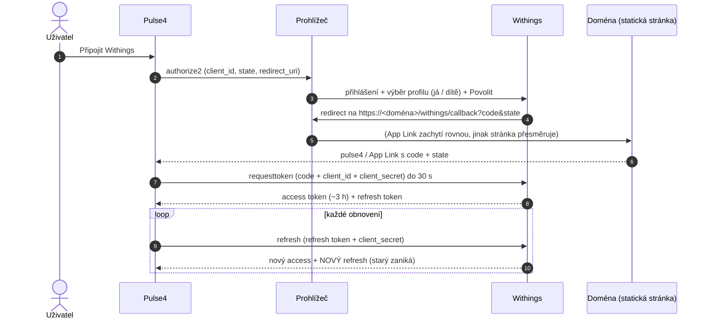

# Withings

Stav k 5. 11. 2026. Pulse4 stahuje z vah Withings váhu a tělesný tuk a zobrazuje je v *Dnes* a *Metrikách*.

## Rozhodnutí (shrnutí)

| Otázka | Rozhodnutí |
|---|---|
| Hlavní cesta k datům | **Přímé Withings API (OAuth)**, protože uživatelé chtějí plná data (tuk, svaly, voda, kosti…). |
| Kdo registruje aplikaci u Withings | **Jednou autor Pulse4** (jedna organizace a jedna aplikace na developer.withings.com). Uživatelé nic neregistrují. |
| Kde je `client_secret` | **V aplikaci** (vloží se při buildu z `local.properties`, mimo git). Pro rodinu a známé je to přijatelné riziko, viz níže. |
| Obnova (rotace) tokenů | **V aplikaci**, žádný server. |
| Návrat z přihlášení | Statická stránka na vlastní doméně (`https://<doména>/withings/callback`). |
| Health Connect | **Nepoužíváme**: uživatelé data do Health Connect neposílají. Kód zůstává, v UI není. |
| CSV a ruční zápis | Zůstávají jako záložní cesty bez připojení. |

> **Stav implementace:** UI pro OAuth, výměna kódu, rotace tokenů, dětský profil a P2P přeposílání jsou hotové.
> **Zbývá:** registrace aplikace u Withings, nasazení callback stránky na doménu, přesunutí `client_id`/`client_secret` z UI
> do buildu a zjednodušení UI na jediné tlačítko „Připojit Withings“. Viz [Otevřené úkoly](#otevřené-úkoly).

---

## Jak přihlášení funguje (lidsky)

Přirovnání k hotelu: **Withings** je hotel s daty, **uživatel** je host, **Pulse4** je poslíček.

1. **Poslíček se jednou zaregistruje v hotelu.** Autor Pulse4 založí na developer.withings.com organizaci a aplikaci
   a dostane **Client ID** (číslo průkazu) a **Client Secret** (heslo poslíčka). Dělá se to jednou za celou aplikaci.
2. **Host dá souhlas.** Uživatel v Pulse4 klikne „Připojit Withings“, otevře se stránka Withings, přihlásí se svým
   běžným účtem (heslo může vyplnit Bitwarden) a klikne „Povolit“. Pulse4 heslo uživatele nikdy nevidí.
3. **Poslíček dostane klíč od pokoje (access token).** S ním Pulse4 stahuje data.
4. **Klíč platí asi 3 hodiny.** Pulse4 ho na pozadí vymění za nový (refresh token). **Při každé výměně chce Withings
   vidět Client Secret**, proto ho musí mít ten, kdo obnovu dělá, v našem případě aplikace.

### Proč je Secret v aplikaci a co to znamená

- Withings v dokumentaci **nenabízí PKCE**, takže mobilní aplikace se bez Secretu neobejde (ani při obnově tokenu).
- Alternativa je malá výměnná služba (např. Cloudflare Worker), která by Secret držela na serveru. Pro okruh rodiny a
  známých jsme ji **zamítli jako zbytečnou** a necháváme ji jako možnost před veřejným vydáním na Google Play.
- **Kdyby někdo Secret z APK vytáhl:** k datům uživatelů se nedostane (potřeboval by souhlas a tokeny konkrétního
  uživatele, ty jsou jen v jeho telefonu v Android Keystore). Mohl by se jen vydávat za Pulse4 a ujídat limit uživatelů.
  Náprava: ve Withings dashboardu přegenerovat Secret a vydat novou verzi.

### Proč je potřeba doména

Po kliknutí „Povolit“ Withings přesměruje jen na `https://` adresu, ne přímo do aplikace (vlastní schéma `pulse4://`
ani `localhost` portál podle dostupných zdrojů nepřijímá, neověřeno). Na doméně proto bude jedna statická stránka:

| Varianta návratu | Popis | Stav |
|---|---|---|
| **App Link** | `/.well-known/assetlinks.json` s SHA-256 otiskem podpisového klíče; Android otevře rovnou Pulse4. | Hotovo v kódu (`docs/withings-applink/`). Otisk se liší pro debug / release / Google Play. |
| **Přesměrovací stránka** | `/withings/callback` přesměruje na `pulse4://withings/callback?code=…` + tlačítko „Otevřít Pulse4“. | Navrženo jako záloha, nezávislá na podpisovém klíči. |
| **GitHub Pages** | Stejná stránka na `livinglegendcz.github.io` (bez vlastní domény). | Alternativa, repo `pulse4` je soukromé → potřeba samostatné veřejné repo. |

Stránka nic neukládá a nemá analytiku. Vidí jen jednorázový kód, který bez Secretu a do 30 s nic neznamená.

### Sekvence

---

## Účty, rodina a dítě

- Každý dospělý se připojí **svým** Withings účtem.
- **Dítě nemá vlastní Withings účet**: je to vedlejší profil (*Family member*) pod účtem rodiče, má ale vlastní `userid`.
  Dítě přitom **má vlastní Garmin**, takže váhu potřebuje ve svém Pulse4.
- Řešení: rodič připojí **druhý OAuth token pro dětský profil** (`withings.child.tokens`, při přihlášení vybere dítě)
  a Pulse4 posílá dětská vážení přes šifrované P2P zprávou `family.weight.push` do telefonu dítěte. Tam se uloží do
  jeho vlastní tabulky `observation` (pokud má dítě zapnuto „Přijímat moji váhu od rodiče“).
- Volitelně lze přeposílat i vážení z rodičova profilu v dětském pásmu (`childWeightMinKg..childWeightMaxKg`,
  výchozí 12–45 kg) nebo poslat váhu ručně.
- **Filtr cizích vážení** (`weightFilterMinKg..MaxKg`, výchozí 45–130 kg) vyřadí z trendu rodiče vážení dítěte nebo
  vážení s dítětem v náručí. Nejednoznačná měření (`attrib` 1/5/8) se drží mimo graf, dokud je uživatel nepotvrdí.

---

## Uživatelské rozhraní (Nastavení → 🔗 Garmin & Withings)

Tři dlaždice nahoře, vždy je vidět jen jedna sekce:

| Dlaždice | Obsah |
|---|---|
| ⌚ **Garmin** | Přihlášení (e-mail s tlačítkem „👤 Vyplnit e-mail z účtů v telefonu“ přímo pod polem, heslo s podporou Bitwardenu, MFA), osobní API klíč s „❓ Kde získat?“, Sync, poslední synchronizace oblastí. |
| ⚖️ **Withings** | Stav, „❓ Kde získat?“ (3 kroky + odkaz na portál + kopírování Callback URL), Client ID/Secret, Připojit/Sync/Odpojit, filtr cizích vážení, ruční zápis a import CSV. |
| 🧒 **Dítě** | 1. komu posílat (P2P kontakt), 2. odkud brát váhu (dětský profil / poslat / ručně), přepínač na telefonu dítěte. |

Kód: `SourcesSettingsSection`, `AccountCard`, `HelpBox` v `app/src/main/kotlin/app/pulse4/android/ui/SettingsHubScreen.kt`.
Snímky: `vault/attachments/settings_accounts_*.png`.

> Pole Client ID/Secret a návod „Kde získat?“ v záložce Withings jsou **přechodné**. Po zabudování přístupů do buildu
> z UI zmizí a zůstane jen „Připojit Withings“.

---

## Zvažované a zamítnuté cesty

| Cesta | Proč ne |
|---|---|
| Každý uživatel si zakládá vlastní organizaci/aplikaci | Nepoužitelné pro běžné lidi. |
| Health Connect | Uživatelé do něj data neposílají; přidává závislost a povolení. |
| Withings → Garmin Connect (partner sync) a čtení z Garminu | Jen váha, ne plná data. U dětských profilů nejisté. |
| E-mail + heslo do neveřejného API aplikace Withings | Nedokumentované, porušuje podmínky, křehké. |
| Čtení přímo z váhy přes Bluetooth | Uzavřený protokol, váha je spárovaná s aplikací Withings. |
| Výměnná služba se Secretem na serveru | Funkční, ale pro malý okruh zbytečná. Zvážit před Google Play. |

---

## Otevřené úkoly

1. **Autor:** na developer.withings.com založit organizaci „Pulse4“ (stačí jméno) a aplikaci *Public API integration*,
   Callback URL `https://<doména>/withings/callback`.
2. Nasadit na doménu callback stránku (a případně `assetlinks.json` s otiskem klíče).
3. Přidat obsluhu `pulse4://withings/callback` jako zálohu App Linku.
4. `client_id` a `client_secret` číst z `local.properties` → `BuildConfig`; build s `-Ppulse4.withingsHost=<doména>`.
5. Zjednodušit záložku Withings na „Připojit Withings“ + stav + odpojit.
6. Na zařízení ověřit: callback, falešný `state`, vypršelý kód (30 s), rotace, pád během obnovy.
7. Ověřit v dashboardu limit bezplatného plánu (podklady uvádějí 10 připojených uživatelů před přezkoumáním).
8. Přepínač „Přijímat moji váhu od rodiče“ se na testovacím telefonu zobrazil vypnutý, ačkoli výchozí hodnota má být
   zapnuto. Prověřit.

## Ověřeno testy (`connector-withings`, falešný server)

Platnost kódu, `state` (náhodný, jednorázový, s TTL), výměna kódu do 30 s, špatný redirect, odmítnutí uživatelem,
rotace refresh tokenu (jedna obnova naráz, uložení před použitím, pád po přijetí odpovědi nezničí relaci, odvolaný token →
nová autorizace), podepsaný režim, `getmeas` se stránkováním, tombstony, jednotky, deduplikace vůči Garminu/CSV,
oprava osoby, CSV (kg/lb, BOM, středník, chybné řádky).

Adresy a parametry Withings API v `WithingsConfig` byly psány bez přístupu k dokumentaci. **Před ostrým provozem je
ověřit** proti developer.withings.com (`requesttoken`, `getnonce`, podpis, `getmeas`, `attrib`, chyby 601/401/293).
